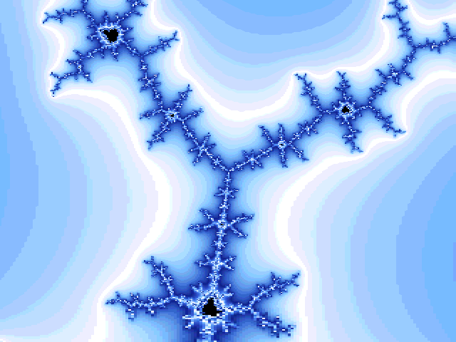
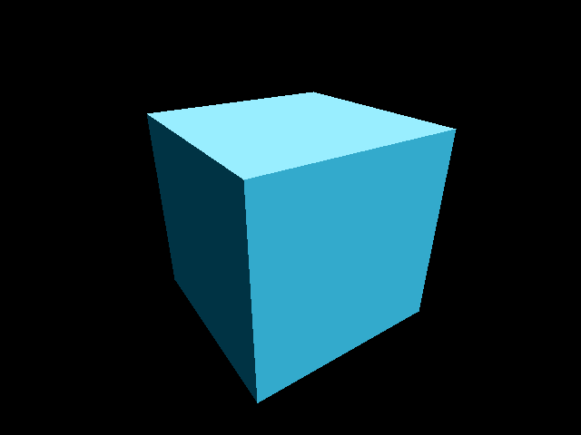
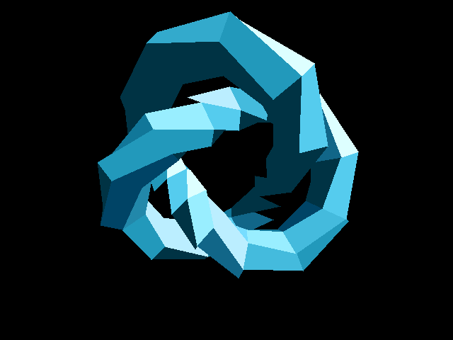

# Atari TT experiments

<table>
<tr>
<td colspan="4" align="center">

</td>
</tr>
<tr>
<td></td>
<td></td>
<td></td>
<td></td>
</tr>
</table>

The demos from [atarist-sfp004](https://github.com/neilrackett/atarist-sfp004),
rebuilt for the Atari TT030 by [Neil Rackett](https://x.com/neilrackett).

## Introduction

An ST can only reach a 68882 through the SFP-004 interface, which maps the
FPU's coprocessor registers into memory and drives every operation by hand.
The TT's 68030 talks to its 68882 directly, so these demos are plain C built
with `-m68030 -m68881`, and the compiler does the rest: FSGLMUL, FSQRT, FCMP
and friends, with the working values kept in FP0–FP7.

They also make use of the rest of the TT:

- TT medium (640×480, 16 colours) for the polygon demos, and TT low
  (320×480, 256 colours) for the raymarcher and the Mandelbrot
- Code in TT-RAM where there is some, with the screens in ST-RAM
- 68030 caches on
- No blitter, so the 68030 clears only what was drawn

| Demo       | Binary                      | Mode   | Speed (TT)¹       | Speed (Mega STE)² |
| ---------- | --------------------------- | ------ | ----------------- | ----------------- |
| Raymarcher | `TORUS.TOS` / `TORUSHI.TOS` | TT low | ~5 fps / ~1.3 fps | Seconds per frame |
| Cube       | `CUBEMESH.TOS`              | TT med | 60 fps            | ~50 fps           |
| Mesh       | `KNOTMESH.TOS`              | TT med | ~15 fps           | ~6 fps            |
| Jet        | `JETMESH.TOS`               | TT med | ~20 fps           | ~10 fps           |
| Mandelbrot | `MANDEL.TOS`                | TT low | 5–8 s a frame     | 10–50 s a frame   |

¹ TT with TOS 3.06.
² From atarist-sfp004: 320×200 in ST low, on a 16 MHz Mega STE with a 68882
(the Mandelbrot in Hatari).

## Demos

### Raymarcher

A rotating (2,3) trefoil torus knot, sphere traced in real time: every pixel
is signed-distance work on the 68882, shaded in 64 colours. `TORUS.TOS`
renders 80×60 blocks, `TORUSHI.TOS` 160×120.

- The distance function needs only multiplies, divides and square roots, a
  single FPU instruction each
- Rays that miss a bounding sphere are skipped, and a cheap torus shell does
  most of the marching before the knot itself is tested
- Each pixel starts from last frame's distance, and alternate pixels are
  drawn on alternate frames
- TT low's pixels are twice as wide as they are tall, so the blocks are 4×8
  (2×4 in `TORUSHI.TOS`) to come out square

### Mesh, cube and jet

The same knot as a 26×6-segment faceted mesh, the traditional spinning cube
(so little geometry that it makes a good benchmark), and the 200-triangle
F-22 from xms0g's [3DOS](https://github.com/xms0g/3Dos), with four materials
each shaded on its own ramp.

- The 68882 rotates and projects the vertices; the 68030 does the backface
  culling, depth-bucket sorting, fixed-point lighting and span filling
- Spans are filled a long (two bitplanes) at a time, by the renderer the
  three demos share in `poly.h`

### Mandelbrot

An endless zoom into the Mandelbrot set, diving 2× a frame towards one of
five self-similar points until the 68882's 64-bit mantissa runs out at 2^46.
208 colours shine outwards from the VBL without a pixel being redrawn.

- The escape loop is inline asm: 8 FPU instructions an iteration, with z
  kept in 80-bit registers and an escape test every third iteration
- Each frame reuses a quarter of the last one's pixels, and guesses others
  whose neighbours agree
- Smooth colouring comes from log2 tables on the 68030, cheaper than FLOG2
- Any key but Esc shows or hides an info bar, in TOS's own system font

## Running

You'll need an Atari TT030 with a 68882 FPU. Copy the `.TOS` files to your TT
and run them from the desktop; Esc quits. The numbers top left are frame
times in ms (split into FPU and painting time in the polygon demos).

To try them in Hatari:

```sh
hatari --machine tt --fpu 68882 --monitor vga --tos "TOS 3.06.img" \
       --memsize 2 --ttram 4 --addr24 off -d dist
```

## Build

The quickest way to build this for yourself is to install
[atarist-toolkit-docker](https://github.com/sidecartridge/atarist-toolkit-docker)
and run:

```sh
stcmd make
```

Outputs the `.TOS` files in the `dist` folder. `make TTLOW=1` builds the
polygon demos for TT low, with finer shading but coarser edges (`make clean`
first). Speed and quality settings are `#define`s near the top of each demo
in `src`.

## Licence

Licensed under the GNU GPL v3 — see [LICENSE](LICENSE). The F-22 model in
`src/f22.h` is from [3DOS](https://github.com/xms0g/3Dos), Copyright (c) 2024
M. Sami GÜRPINAR, under the BSD 3-Clause License.
